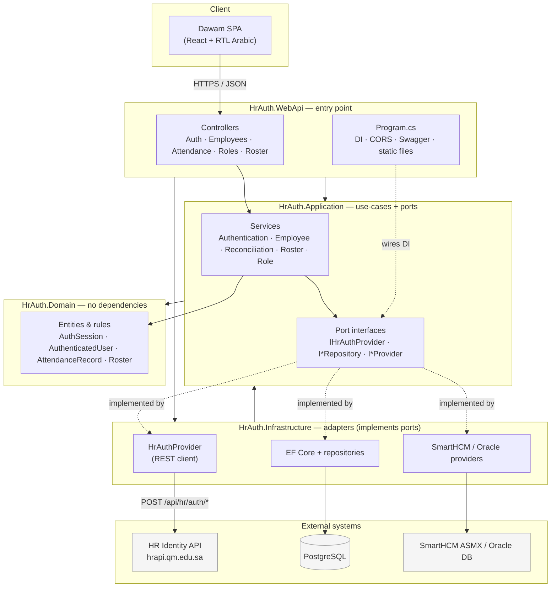

# HrAuth.CleanArchitecture — Project Overview

> A Clean Architecture ASP.NET Core 9 application that authenticates Qassim University (QM)
> HR staff against the central HaramAPI identity service, then provides employee directory,
> attendance reconciliation, roster, and role-management features through an RTL Arabic SPA
> branded **Dawam** (دوام).

---

## 1. What this project does

HrAuth is an HR back-office tool. Its core responsibilities:

1. **Authentication** — Log users in against the external HR identity API (`hrapi.qm.edu.sa`),
   manage token refresh and validation, and keep a local audit record of each employee who logs in.
2. **Employee directory** — List/search employees, add them manually or via CSV import, and sync
   their position & supervisor from SmartHCM.
3. **Attendance reconciliation** — Import attendance-machine punch exports (or pull raw punches from
   Oracle), match them against shift rosters, and report late arrivals, early departures, and
   missing periods.
4. **Roles & rosters** — Maintain a role catalog, assign roles to employees, and manage shift rosters.

The front-end is a no-build React SPA (**Dawam**) that ships from `wwwroot`.

---

## 2. Architecture at a glance

The solution (`HrAuth.sln`) follows **Clean Architecture** with four projects and a strict
inward-pointing dependency rule:

```
┌──────────────────────────────────────────────────────────┐
│  HrAuth.WebApi      Controllers, Program.cs, wwwroot SPA   │  ← entry point
│      depends on ↓                                          │
│  HrAuth.Infrastructure   EF Core, HrAuth client, SmartHCM  │  ← implements ports
│      depends on ↓                                          │
│  HrAuth.Application      Services (use-cases), interfaces   │  ← defines ports
│      depends on ↓                                          │
│  HrAuth.Domain           Entities, domain rules            │  ← no dependencies
└──────────────────────────────────────────────────────────┘
```

- **Domain** has no external dependencies.
- **Application** defines interfaces (ports) such as `IHrAuthProvider` and `IEmployeeRepository`
  and orchestrates use-cases. It depends only on Domain.
- **Infrastructure** implements those ports (EF Core for Postgres, HTTP clients for HrAuth and
  SmartHCM, Oracle access).
- **WebApi** wires everything together via DI and exposes REST controllers + the static SPA.

**Error handling convention:** Cross-layer outcomes use a `Result<T>` type
(`Application/Common/Result.cs`) instead of throwing exceptions across boundaries.

### Architecture diagram



Dependencies point **inward** (WebApi → Infrastructure → Application → Domain). The dashed
*"implemented by"* edges show dependency inversion: Application defines the ports, Infrastructure
supplies the concrete adapters, and `Program.cs` wires them at startup.

---

## 3. Technology stack

| Area | Technology | Version |
|------|------------|---------|
| Runtime | .NET / ASP.NET Core | 9.0 |
| Language | C# (nullable refs, implicit usings) | 13 |
| ORM | EF Core + Npgsql (PostgreSQL) | 9.0.4 |
| Oracle | Oracle.ManagedDataAccess.Core | 23.6.1 |
| API docs | Swashbuckle (Swagger) | 10.1.7 |
| Front-end | React (CDN UMD) + Babel standalone | 18.3.1 / 7.29.0 |
| Icons | Tabler Icons (web font) | 3.5.0 |
| Database | PostgreSQL | — |

The front-end has **no build step** — JSX is transpiled in the browser by Babel standalone.

---

## 4. Project layout

```
HrAuth.CleanArchitecture/
├── HrAuth.sln
├── README.md
└── src/
    ├── HrAuth.Domain/          Entities + domain rules (no deps)
    ├── HrAuth.Application/     Use-case services + port interfaces + DTOs
    ├── HrAuth.Infrastructure/  EF Core, HrAuth client, SmartHCM/Oracle adapters
    └── HrAuth.WebApi/          Controllers, Program.cs, appsettings, wwwroot SPA
```

### Domain (`src/HrAuth.Domain`)
- `Entities/AuthSession.cs`, `Entities/AuthenticatedUser.cs` (roles, `IsInRole`, `IsAdministrator`)
- `Attendance/AttendanceRecord.cs`, `Attendance/EmployeeIdRules.cs` (8-digit ID normalization)
- `Rosters/Roster.cs`, `Rosters/RosterPeriod.cs`

### Application (`src/HrAuth.Application`)
- **Ports (interfaces):** `Abstractions/IHrAuthProvider.cs`; `Persistence/I*Repository.cs`;
  `Attendance/IAttendanceSummaryProvider.cs`, `IRawPunchProvider.cs`; `Employees/IEmployeeDirectoryProvider.cs`;
  `Rosters/IRosterProvider.cs`
- **Use-case services:** `AuthenticationService`, `EmployeeService`, `EmployeeDirectoryImportService`,
  `AttendanceReconciliationService`, `AttendanceImportService`, `RosterService`, `RoleService`
- **DTOs:** `AuthResult`, `LoginRequest`, `RefreshTokenRequest`, attendance/employee DTOs
- `Common/Result.cs`, `DependencyInjection.cs` (`AddApplication()`)

### Infrastructure (`src/HrAuth.Infrastructure`)
- **HrAuth client:** `HrAuth/HrAuthProvider.cs` (REST calls to HR API),
  `HrAuthSessionParser.cs` (tolerant snake_case/camelCase parsing), `HrAuthOptions.cs`, `ApiResponse.cs`
- **Persistence:** `Persistence/HrAuthDbContext.cs`, entity models, repositories, `Migrations/`
- **SmartHCM/Oracle:** `SmartHcm/SmartHcmClient.cs`, directory/roster/attendance providers,
  `OracleEmployeeDirectoryProvider.cs`, `OracleRawPunchProvider.cs`, `SmartHcmCrypto.cs`
- `DependencyInjection.cs` (`AddInfrastructure(configuration)`) — typed HttpClients, DbContext,
  conditional provider selection (SmartHCM API → Oracle → ASMX fallback)

### WebApi (`src/HrAuth.WebApi`)
- **Controllers:** `AuthController`, `EmployeesController`, `AttendanceController`,
  `RolesController`, `RosterController`
- `Program.cs`, `appsettings.json`, `wwwroot/` (Dawam SPA + legacy pages)

---

## 5. REST API surface

| Method & Route | Purpose |
|----------------|---------|
| `POST /api/auth/login` | Log in (`LoginRequest` → `AuthResult`) |
| `POST /api/auth/refresh-token` | Refresh access token |
| `POST /api/auth/validate-token` | Validate `Authorization: Bearer` token |
| `GET  /api/employees` | Paginated list + search by ID/name |
| `GET  /api/employees/{id}` | Single employee |
| `POST /api/employees` | Add one employee |
| `POST /api/employees/{id}/sync-from-smarthcm` | Sync position & supervisor |
| `PUT  /api/employees/{id}/roles` | Set roles |
| `POST /api/employees/import-csv` | Bulk CSV import (≤10 MB, auto-delimiter) |
| `POST /api/attendance/upload` | Upload punch export, reconcile vs rosters |
| `GET  /api/attendance/fetch-raw` | Pull raw Oracle punches for a date range |
| `GET  /api/attendance/fetch` | Fetch SmartHCM daily summary for an employee |
| `…/api/roles`, `…/api/roster` | Role catalog & roster CRUD |

Swagger UI is available at `/swagger` in Development.

---

## 6. Authentication flow

```
Browser (Dawam login)
  └─ POST /api/auth/login {userName, password}
      └─ AuthController → AuthenticationService
          └─ IHrAuthProvider.LoginAsync()         (port → HrAuthProvider)
              └─ POST https://hrapi.qm.edu.sa/api/hr/auth/login
                 (optional X-Hr-Login-Gateway-Token header)
          ← ApiResponse {success, data:{token, refresh_token, user_id, …}}
          └─ HrAuthSessionParser → AuthSession (domain)
          └─ EmployeeRepository.UpsertAsync(...)   (local audit row)
      ← AuthResult {accessToken, refreshToken, expiresAt, userId, username, displayName, roles}
  └─ sessionStorage["hrauth.session"] = AuthResult → navigate to dashboard
```

- Token **refresh** and **validation** follow the same port → provider → HR API pattern.
- The front-end auto-logs-out after **10 minutes** of inactivity.
- The local DB does **not** store credentials — only an employee audit record (first seen / last login).

---

## 7. Database (PostgreSQL)

Four tables, managed by EF Core migrations:

| Table | Key columns |
|-------|-------------|
| `employees` | `EmployeeId` (PK), `UserName`, `DisplayName`, `Position`, `SupervisorEmployeeId`, `Roles` (text[]), `FirstSeenUtc`, `LastLoginUtc` |
| `attendance_records` | `Id` (PK), `EmployeeId`, `RawEmployeeId`, `Timestamp`, `Status/Verify/WorkCode/Reserved`, `SourceFile`, `ImportedUtc` |
| `reconciliation_runs` | `Id` (uuid PK), `FileName`, counts (late/early/missing), `DaysJson` (jsonb) |
| `roles` | `Name` (PK), `Description` |

- `Roles` uses a native PostgreSQL `text[]` array; `DaysJson` uses `jsonb`.
- Migrations: `InitialCreate` → `AddRoleCatalog` → `AddEmployeePositionAndSupervisor`.
- The app applies migrations on startup (best-effort; it continues if the DB is unavailable).

---

## 8. Front-end — Dawam SPA

Located in `src/HrAuth.WebApi/wwwroot/dawam/`. React 18 + Babel standalone, RTL Arabic.

Loaded in order from `wwwroot/index.html`:
1. `app-i18n.js` — translations
2. `app-data.js` — API helpers (`apiGet`/`apiSend`), session storage, Arabic date formatting
3. `app-shell.js` — nav/layout
4. `app-dashboard.js` — dashboard
5. `app-reconciliation.js` — reconciliation UI
6. `app-screens.js` — screen registry
7. `app-main.js` — root app, login screen, idle auto-logout

Styling: `dawam/dawam.css`, `dawam/colors_and_type.css`. Older **jQuery legacy pages**
(`*-legacy.html`, `dashboard.js`, `employees.js`, etc.) remain in the codebase alongside the SPA.

---

## 9. Configuration (`appsettings.json`)

```jsonc
{
  "ConnectionStrings": { "Postgres": "", "Oracle": "" },
  "AttendanceReconciliation": {
    "GraceMinutes": 15,             // default lateness/early tolerance (see §11)
    "GraceMinutesByPosition": {     // optional per-position overrides
      "Position 1": 20,
      "Position 3": 10
    }
  },
  "HrAuth": {
    "BaseUrl": "https://hrapi.qm.edu.sa",
    "GatewayToken": "",              // optional secure-client mode
    "AcceptUntrustedCertificate": true,
    "TimeoutSeconds": 30
  },
  "SmartHcm": {
    "BaseUrl": "https://hr.qm.edu.sa/ws/SmartHCMWS.asmx",
    "TokenKey": "", "SecurityKey": "",
    "DirectoryAdminEmpId": "", "DirectoryAdminPassword": "",
    "AcceptUntrustedCertificate": true, "TimeoutSeconds": 30
  }
}
```

> **Secrets** (`GatewayToken`, SmartHCM keys/admin password, DB passwords) should come from
> environment variables or user-secrets — **not** source control.

---

## 10. Attendance reconciliation rules (grace / lateness)

When an attendance file is uploaded, `AttendanceReconciliationService` matches each punch
against the employee's roster periods and flags **missing periods**, **late arrivals**, and
**early departures**. The tolerance is a single **grace margin** used three ways: to decide
whether a punch belongs to a period, to forgive a late arrival, and to forgive an early
departure.

**The rule:** an employee is *late* for a period when their first matched punch lands **more
than the grace margin** after the period start. Within the margin counts as on-time. The same
applies, mirrored, to early departure against the period end. Grace is *all-or-nothing* — once
you cross it, the **full** lateness is recorded, not the amount beyond the margin.

### Configurable grace (`AttendanceReconciliation` section)

| Setting | Type | Meaning |
|---------|------|---------|
| `GraceMinutes` | int | **Default** tolerance in minutes (was hard-coded to 15). Used for any employee with no position-specific override. |
| `GraceMinutesByPosition` | map of `position → minutes` | **Per-position overrides**. Keyed on the employee's `Position` (the value in `employees.Position`), matched **case-insensitively**. |

**Resolution per employee:** the service looks up the employee's stored position; if that
position appears in `GraceMinutesByPosition` it uses that value, otherwise it falls back to
`GraceMinutes`. Negative values are clamped to `0`.

```jsonc
"AttendanceReconciliation": {
  "GraceMinutes": 15,             // everyone else
  "GraceMinutesByPosition": {
    "Position 1": 20,            // ← replace keys with real position names
    "Position 3": 10            //   (the text shown in the Employees "المنصب" column)
  }
}
```

> ⚠️ The map keys must match the **position name** stored on the employee — that field holds a
> title synced from SmartHCM, not a numeric code. The `"Position 1"` / `"Position 3"` keys above
> are placeholders; replace them with your actual position names.

**Implementation notes:**
- Bound in `Application/DependencyInjection.cs` via `services.Configure<AttendanceReconciliationOptions>(...)`;
  injected into the service as `IOptions<AttendanceReconciliationOptions>`.
- Positions are fetched once per upload through the `IEmployeeRepository.GetPositionsAsync`
  port (implemented in `EmployeeRepository`), then `ResolveGrace(position)` picks the margin
  before each day is reconciled.
- The resolved `Position` is also surfaced on each `EmployeeDayReconciliationDto` (and the
  persisted run), so reports can show which position drove the tolerance.
- Read once at startup via `IOptions<T>` (consistent with `HrAuthOptions`/`SmartHcmOptions`) —
  changing the config requires an app restart.

---

## 11. Running locally

```bash
dotnet run --project src/HrAuth.WebApi/HrAuth.WebApi.csproj \
  --urls "http://localhost:5080;https://localhost:7080"
```

- App URLs: `http://localhost:5080` and `https://localhost:7080`.
- The explicit `--urls` avoids a clash with a global `ASPNETCORE_URLS` on this machine.
- If the HTTPS dev cert is untrusted, run `dotnet dev-certs https --trust` once, or use the HTTP URL.
- Requires a reachable PostgreSQL instance (connection string in `appsettings.json` or
  `ConnectionStrings__Postgres`). SmartHCM/Oracle features need their respective config/credentials.

---

## 12. Key takeaways for a new contributor

- **Add a use-case?** Define the interface + service in `Application`, implement any external
  dependency as a port in `Infrastructure`, expose it via a controller in `WebApi`.
- **Never throw across layers** — return `Result<T>`.
- **External identity is authoritative** — HrAuth never validates passwords itself; it delegates to
  `hrapi.qm.edu.sa`. The local DB is for directory/audit/attendance data only.
- **Provider selection is conditional** — directory/attendance data comes from SmartHCM API, Oracle,
  or an ASMX fallback depending on which credentials/connection strings are configured
  (see `Infrastructure/DependencyInjection.cs`).
- The **Dawam SPA** is the current UI; jQuery legacy pages are kept but superseded.
```
